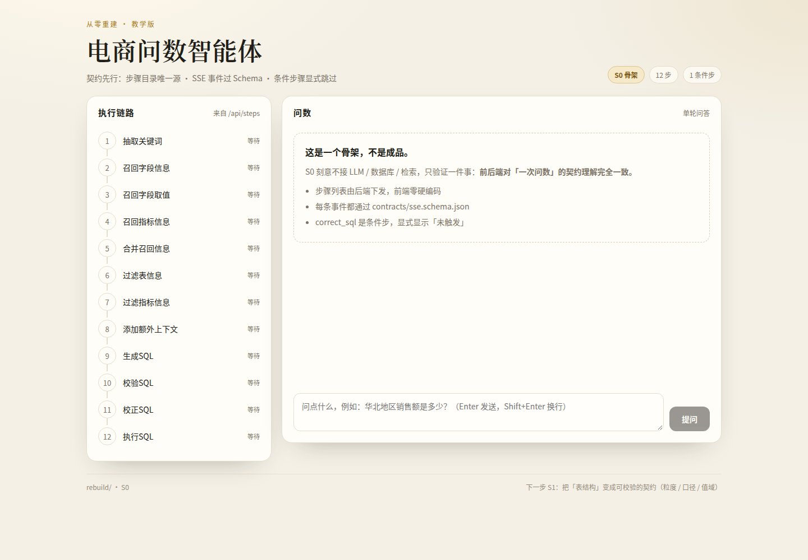
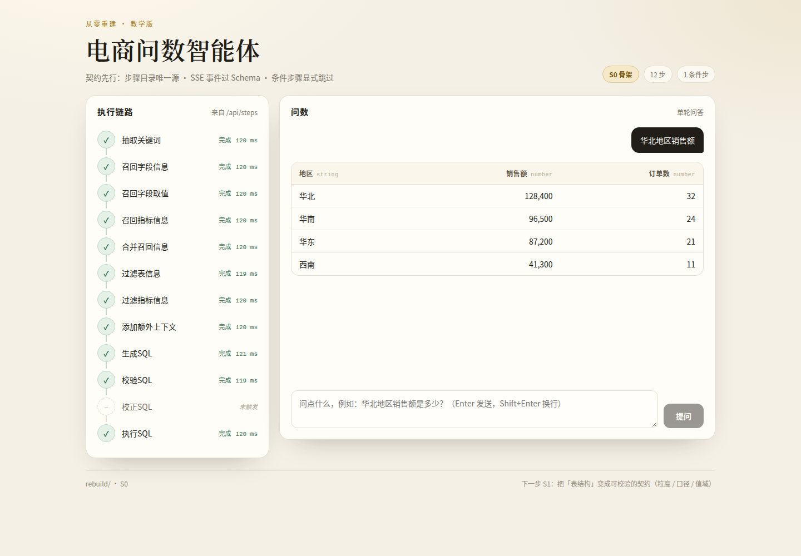

# 电商问数智能体 · 从零重建（教学版）

> 这不是旧系统的重构，而是**按契约从零搭的第二套实现**。
> 旧系统（`../shopkeeper-agent` + `../shopkeeper-agent-frontend`）冻结为 `legacy`，
> 作为**反例库**与负向夹具来源。

- 路线图：`../shopkeeper-agent/docs/REBUILD-ROADMAP.md`
- 从零搭建 / 排障 / 环境变量：[`docs/SETUP-FROM-SCRATCH.md`](docs/SETUP-FROM-SCRATCH.md)
- S7 设计记录：[`docs/S7-HANDOFF.md`](docs/S7-HANDOFF.md)
- Docker 部署：[`docs/DOCKER-DEPLOY.md`](docs/DOCKER-DEPLOY.md)

---

## 当前进度

| 阶段 | 状态 | 验收 |
|---|---|---|
| **S0 骨架** | ✅ 完成 | `make stage0` |
| **S1 Schema 契约** | ✅ 完成 | `make stage1` |
| **S2 元知识构建** | ✅ 完成 | `make stage2` |
| **S3 检索** | ✅ 完成 | `make stage3` |
| **S4 生成 SQL** | ✅ 完成 | `make stage4` |
| **S5 安全边界** | ✅ 完成 | `make stage5` |
| **S6 失败通道** | ✅ 完成 | `make stage6` |
| **S7 前端收口** | ✅ 完成 | `make stage7` + `make stage7-ui` |
| S8 性能 | ⬜ 待做 | 路线图定义；Makefile 里还没有 `stage8` 目标 |

当前验收数据：后端 **782 passed / 31 skipped**，前端 **40 passed**，
SSE 夹具 **14 条**，`tsc --noEmit` 零错误。

---

## 快速开始

前置：Python ≥ 3.12、uv、Node.js LTS + npm、GNU Make；S2/S3 另需 Docker。

```bash
make install          # 首次：uv sync --frozen + npm ci

# 终端 1
make dev-backend      # http://127.0.0.1:8100

# 终端 2
make dev-frontend     # http://127.0.0.1:5273
```

打开 http://127.0.0.1:5273 提问，步骤条会依次点亮。
健康检查返回 `{"status":"ok","stage":"S7"}`。

### Docker 一键部署

前置：Docker Compose v2；首次构建需要网络。

```bash
make docker-env      # 生成 .env（随机密码；已存在则跳过）
make docker-up       # 构建并启动五服务 + 一次性 init
curl http://127.0.0.1:8080/api/health
make docker-smoke    # 完整验收
```

详见 [`docs/DOCKER-DEPLOY.md`](docs/DOCKER-DEPLOY.md)。

> **Windows**：先执行 `chcp 65001`。控制台默认 GBK，`make` 自己 echo 的中文
> 可能触发 `UnicodeEncodeError`；Python CLI 内部已固定 UTF-8。

---

## 验收命令

| 命令 | 验什么 | 前置 |
|---|---|---|
| `make stage0` | 契约测试 + 前端协议单测 + 构建 | 无 |
| `make stage1` | 契约 ↔ DDL/数据；旧系统负向夹具必须红 | 无 |
| `make stage2` | 三存储构建 + manifest 对账 + 幂等 | MySQL / ES / Qdrant |
| `make stage3` | 20 题黄金集 + 检索 YAML + 往返次数 | 三存储 + S2 已构建 |
| `make stage4` | 10 题基线 + 提示词/静态校验 | 无 |
| `make stage5` | 36 条注入语料 100% 拒绝 + 11 条零误杀 | 无 |
| `make stage5-live` | 只读账号开通/验证 + 新旧两屏对比 | MySQL + `REBUILD_DW_RO_PASSWORD` |
| `make stage6` | 16 个错误码 + 6 类失败 + 校正闭环 + 取消 | 无 |
| `make stage6-ui` | 6 类失败各一种界面 + 取消 | Chrome / Edge |
| `make stage7` | 生成物新鲜度 + 14 条 SSE 夹具 + 前端契约测试 | 无 |
| `make stage7-ui` | F1–F13 共 14 条浏览器断言 | Chrome / Edge |
| `make baseline` | 只看 S4 的 10 题基线表格 | 无 |

`make stage2/3` 只操作 `*_rebuild` 目标，不动旧系统的库、索引和 collection。
`make stage4/5/6/7` 完全离线：不需要 MySQL、LLM 或 API key。

---

## 核心设计

### 1. 契约是唯一事实源

| 文件 | 内容 |
|---|---|
| `contracts/steps.yaml` | 12 个步骤；`correct_sql` 标为 `conditional` |
| `contracts/sse.schema.json` | 三种 SSE 事件：`progress` / `result` / `error` |
| `contracts/schema.contract.yaml` | 5 表 / 24 列 / 6 指标的语义契约 |
| `contracts/sql.output.schema.json` | 只允许 `sql` 或 `refusal` 两种形状 |
| `contracts/sql.policy.yaml` | 安全参数：行数上限、超时、禁词、只读账号 |
| `contracts/errors.yaml` | 16 个错误码 / 3 种失败类别 / 校正策略 |
| `contracts/prompts/` | 7 个提示词；frontmatter 的 `slots` 是唯一声明 |

后端和前端都从契约**派生**：步骤目录与错误码表由 API 下发；前端事件类型由
`contracts_gen` 生成，手写枚举不再存在。**生成物不要手改**（见 S7）。

### 2. 问数流水线

```
问题
  -> 上下文 8 阶段（契约离线裁剪 / 可选 S3 召回）
  -> generate_sql（确定性生成器；可切换 LLM）
  -> validate_sql（AST 静态校验 + AST 安全策略）
  -> [correct_sql]（仅可重试错误；最多 1 次；改完重新校验）
  -> run_sql（只读账号 + 超时）
  -> result / error（流一定以其中之一收尾）
```

### 3. 失败有名字，且长得不一样

`class` 决定界面，不是错误码决定：

| `class` | 界面 | 步骤条 |
|---|---|---|
| `failure` | 红框 + 错误码 + 可复制详情 | 失败步骤红叉 |
| `empty` | 虚线空态卡；`[]` 是合法语义，不标红 | 执行步骤保持绿色 |
| `cancelled` | 中性卡 | 正在跑的步骤标「已取消」 |

### 4. 安全边界

SQL 在**连库之前**过六道检查：可执行注释/词法禁词 → 单语句 → 只读 →
集合运算/危险函数 → 契约派生的表列白名单 → 去注释 + 自动 LIMIT。
执行的是策略**重新序列化后的那条 SQL**，不是原始文本；数据库账号只有 `SELECT`，
并叠加 `max_execution_time` 与「不许多语句」。

### 5. 类型保真

`DECIMAL("10")` → `10`（不是 `"10"`），`DECIMAL("10.5")` → `10.5`，
`DATE` → ISO 字符串且列类型仍是 `date`；未知类型直接抛错变成 `INTERNAL_ERROR`。
`_sse` 刻意不传 `default=str`——降级成字符串正是审计 B4 的缺陷本身。

---

## 各阶段完成情况

### S0 · 骨架

不接 LLM / 数据库 / 检索，只跑通「一次问数」的契约：12 个步骤、3 种 SSE 事件、
一条 24 帧假流。前端用运行时类型守卫拒绝未知事件/步骤，失败、断流、网络错误
统一收敛为错误态。

关键源码：`backend/app/main.py`、`frontend/src/lib/api.ts`、`contracts/`。

**命令**

```bash
make install       # 首次：安装 Python / Node 依赖
make stage0        # 契约 + 协议单测 + 类型检查/构建
make stage0-ui     # 可选：真实浏览器冒烟（Chrome / Edge）
```

### S1 · Schema 契约

把表结构变成可校验契约：每表声明 `grain` / 外键 / 指标，每列声明 `role` /
`value_domain` / 别名，每个指标声明 `formula` / `expected_value`。
检查器把 `fixtures/dw.sql` 装进内存 SQLite，校验结构与真实值；旧系统的冻结夹具
必须持续检出 8 个代码 / 14 条问题。`docs/SCHEMA-CONTRACT.md` 自动生成并检查新鲜度。

关键源码：`contracts/schema.contract.yaml`、`backend/app/schema_contract.py`。

**命令**

```bash
make stage1

# 单独检查契约 / 确认旧系统夹具仍然报错
(cd backend && uv run python -m app.schema_contract --check)
(cd backend && uv run python -m app.schema_contract --expect-legacy-red)
```

### S2 · 元知识构建

把契约写入三份可检索元知识：MySQL `meta_rebuild`、ES `value_index_rebuild`、
Qdrant `column_info_rebuild` / `metric_info_rebuild`。每次成功构建写
`build_manifest`（`config_hash` / 计数 / 目标 / 状态）；相同契约第二次构建必须
`NOOP: 0 writes`。Embedding 默认用确定性的 `hash-ngram-v1`，不依赖模型下载。

关键源码：`backend/app/build_meta_knowledge.py`、`backend/app/build/`。

**命令**

```bash
# 本地开发：在仓库根目录只启动三存储（首次需 make docker-env）
make docker-env
docker compose up -d mysql elasticsearch qdrant

# Compose 密码是随机生成的；宿主 CLI 不会自动读 .env
source scripts/export-docker-env.sh

make stage2

# 常用单步：三存储对账 / 幂等检查
cd backend
uv run python -m app.build_meta_knowledge --verify
uv run python -m app.build_meta_knowledge --assert-idempotent
```

### S3 · 检索

不接 LLM：契约词典 + 日期正则 + 完整问题兜底提取关键词；每道题固定
ES 1 次 `_msearch`、Qdrant 2 次批量搜索、Meta 5 条 SQL，防止退化成 N+1。
候选合并后用词法补偿分与阈值过滤，输出逐字节稳定的 YAML 上下文；
20 题黄金集 **20/20 通过**。

关键源码：`backend/app/recall/`、`backend/tests/recall/golden.yaml`。

**命令**

```bash
# 前置：S2 已完成，三存储对账通过
# 新终端里先导出 Compose 凭据；S2 块的导出不会跨终端保留
source scripts/export-docker-env.sh
make stage3

# 单题检索：YAML 到 stdout，统计到 stderr
(cd backend && uv run python -m app.scripts.recall "华北销售额")
```

### S4 · 生成 SQL

7 个提示词槽位严格校验；输出只允许 `sql` 或 `refusal`。静态校验用 sqlglot AST，
覆盖多语句、非只读、未知表/列、常量投影、排名缺 ORDER BY/LIMIT。
确定性生成器保证 10 题基线可复现（**10/10 通过**）；LLM 只是可选实现，
生成的 SQL 同样要过全部静态校验。S4 不执行 SQL（留给 S5/S6）。

关键源码：`backend/app/generate/`、`contracts/prompts/`。

**命令**

```bash
make stage4        # 10 题基线 + 生成层测试 + 全量回归
make baseline      # 只看「问题 / SQL / 判定」表格

# 单题生成（不执行 SQL）
(cd backend && uv run python -m app.scripts.generate "华北销售额")
```

### S5 · 安全边界

AST 级策略 + 只读执行器：注入语料 **36/36 拒绝**、正常查询 **11/11 放行**。
白名单从 `schema.contract.yaml` 派生，不在策略文件里抄第二份。
`make stage5-live` 用一次性探针表复现旧系统「第二句 DROP 真执行」，新系统
`SQL_MULTIPLE_STATEMENTS` 拒绝且探针表仍在。

关键源码：`backend/app/security/`、`fixtures/injection/sql-injection.yaml`。

**命令**

```bash
make stage5        # 离线门禁：36 条注入语料 + 11 条正常查询

# 单条 SQL 的策略判定
(cd backend && uv run python -m app.scripts.security --policy "SELECT 1 FROM fact_order; DROP TABLE fact_order")

# 实战验收：需要已装载 dw 的 MySQL
# Compose 密码是随机生成的；helper 同时导出只读、root 与 app 凭据
source scripts/export-docker-env.sh
make stage5-live
```

`source scripts/export-docker-env.sh` 同时导出 `REBUILD_MYSQL_ROOT_PASSWORD`
（开通账号）以及 `REBUILD_MYSQL_USER` / `REBUILD_MYSQL_PASSWORD`（两屏对比 demo），
详见 SETUP 手册。

### S6 · 失败通道

真流水线替换 S0 假流；错误码表 16 个码，校正闭环最多 1 次且校正后**重新过**
静态校验与安全策略（校正不是绕过检查的后门）。取消是第三种状态 `cancelled`，
不是 `done`。`app/scenarios/` 与生产共用 HTTP/SSE 管道，只替换模型与数据库，
因此 6 类失败可复现、界面各自不同。

关键源码：`backend/app/agent/`、`backend/app/scenarios/`、
`fixtures/failures/scenarios.yaml`。

**命令**

```bash
make stage6        # 离线门禁：错误码表 + 6 类失败 + 校正/取消
make stage6-ui     # 6 类失败界面 + 取消（Chrome / Edge）

# 可选：手动启动场景应用
# 终端 1
cd backend && uv run python -m app.scenarios.app --port 8102
# 终端 2（仓库根目录）
cd frontend && VITE_DEV_PROXY_TARGET=http://127.0.0.1:8102 npm run dev
```

### S7 · 前端收口

事件类型、运行时 schema、步骤/错误码由契约生成；前端 `switch(event.type)`，
未知事件**忽略并提示**。13 条缺陷闭环：

| 组 | 修法 |
|---|---|
| F1/F2 取消 | 状态显示「已取消」，running 步骤中性态，不标红、不渲染结果 |
| F3 未知事件 | 忽略 + 提示条，不弹错误卡 |
| F4/F5/F6 结果语义 | 空数组显示「没有数据」；伪 SQL 行用 `PseudoErrorCard` 止损；全 NULL 列显式标注 |
| F7/F11 错误 | 错误卡显示失败步骤；422 →「问题格式不对」，5xx →「问数服务异常」 |
| F8/F9/F12 布局与步骤 | 响应式；条件步显示「未触发」；每步显示耗时 |
| F10/F13 数字 | 千分位格式化；复制 JSON，数字不会被复制成字符串 |

SSE 夹具 14 条（10 条录制 + 4 条手写：伪 SQL 行/未知事件/空数组/全 NULL），
录制只归一化 `duration_ms` 与 `request_id`。回放服务器按生产协议吐夹具，
`make stage7-ui` 用 14 条断言覆盖 F1–F13。后端新增契约/夹具/类型保真测试 59 条。

关键源码：`backend/app/scripts/contracts_gen.py`、`record_sse.py`、
`frontend/src/generated/`、`frontend/src/lib/`、`frontend/tests/`。

**命令**

```bash
make stage7        # 生成物/夹具/契约/单测/构建 + 全量后端
make stage7-ui     # 回放夹具 + 14 条浏览器断言（Chrome / Edge）

# 改契约后重新生成前端类型；改流后重录夹具（不要手改 generated）
(cd backend && uv run python -m app.scripts.contracts_gen)
(cd backend && uv run python -m app.scripts.record_sse)
```

---

## 关键源码目录

```text
rebuild/
├── contracts/                  # 契约：步骤/SSE/Schema/策略/错误码/提示词
├── fixtures/                   # dw.sql、旧系统负向夹具、注入语料、失败场景、SSE 夹具
├── backend/
│   ├── app/main.py             # HTTP + SSE 入口
│   ├── app/schema_contract.py  # S1 检查器 + 文档生成
│   ├── app/build/              # S2 构建/embedding/三存储/manifest
│   ├── app/recall/             # S3 关键词/批量召回/过滤/YAML
│   ├── app/generate/           # S4 上下文/提示词/生成器/静态校验
│   ├── app/security/           # S5 策略/执行器/只读账号
│   ├── app/agent/              # S6 错误码/校正/编排/取消 + S7 值归一化
│   ├── app/scenarios/          # S6 场景应用
│   ├── app/scripts/            # 各阶段 CLI（recall/generate/security/failures/契约生成/录制）
│   └── tests/                  # 后端测试（S0–S7）
├── frontend/
│   ├── src/generated/          # ★ 生成物，不要手改
│   ├── src/lib/                # SSE 解析、JSON Schema、结果表语义
│   ├── src/components/         # StepRail / ErrorCard / PseudoErrorCard
│   └── tests/                  # 无头浏览器 + 回放服务器
├── scripts/                    # stage0-ui / stage6-ui / stage7-ui（隔离端口）
├── docs/                       # SETUP、Schema 文档、截图
└── Makefile
```

---

## 必须知道的约束

1. **契约先行**：先钉契约，再填实现。契约改了要重新生成前端类型：
   `cd backend && uv run python -m app.scripts.contracts_gen`；
   `--check` 会检查生成物是否过期。
2. **生成物不要手改**：`frontend/src/generated/` 是机器产物。
3. **只动 rebuild 目标**：S2/S3 不修改旧系统的 `meta` / `value_index` /
   `column_info_collection` / `metric_info_collection`；不要 `docker compose down -v`。
4. **S2/S3 的外部前置**：仓库根 `compose.yaml` 可只启动
   `mysql elasticsearch qdrant`；ES 使用官方镜像，S2 自动回退 `standard`
   analyzer，IK 是后续可选增强。S2 默认哈希向量，不需要 embedding 容器。
5. **S5 实战需要 MySQL**：`REBUILD_DW_RO_PASSWORD` 由环境提供，不在仓库里。
6. **浏览器验收需要 Chrome / Edge**：`playwright-core` 不自带浏览器；
   Windows 上用 Edge 即可。
7. **端口隔离**：后端 8100 / 前端 5273；临时验收 8101/5274（S0）、
   8102/5275（S6）、8103/5276（S7），可与旧系统 8000/5173 同时运行。
8. **排障**：先看 [`docs/SETUP-FROM-SCRATCH.md`](docs/SETUP-FROM-SCRATCH.md)
   的常见故障表；Windows 中文输出问题先 `chcp 65001`。

---

## 为什么 S0 不装数据库

审计把 30+ 条缺陷收敛到三个根因，第一条是：

> **契约只写在提示词、YAML 和文档里，没有一行代码强制它。**

如果先装数据库、再写检索、最后对前端，这个根因会被固化进每一层。
所以第一个可运行的系统先钉死契约，后面的阶段只能「填实现」，不能改契约。

---

## S0 截图

| 初始态 | 执行完成 |
|---|---|
|  |  |

左：12 步全部「等待」。右：11 步绿色勾 + 耗时，`校正SQL` 显示「未触发」，
结果表 4 行。
